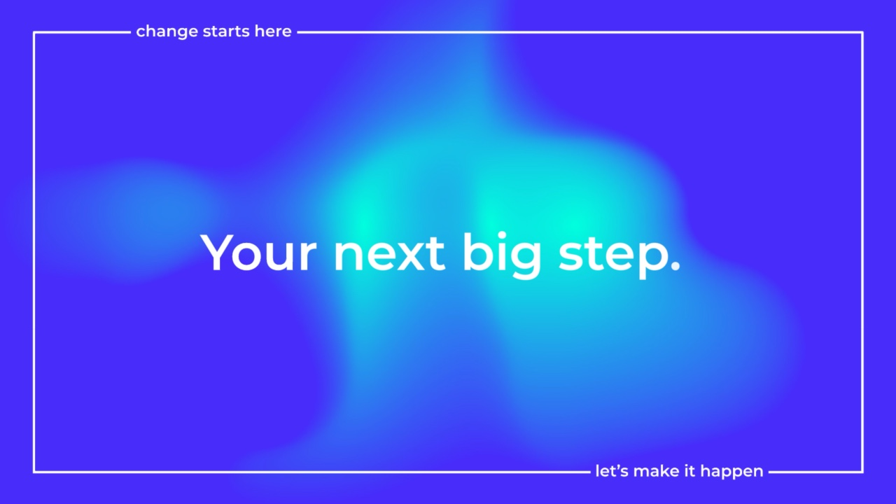
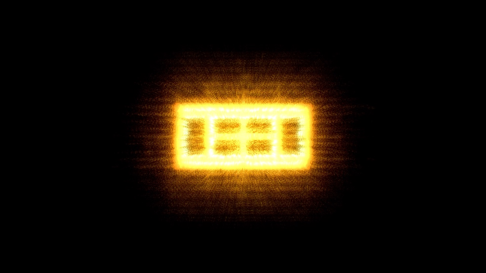
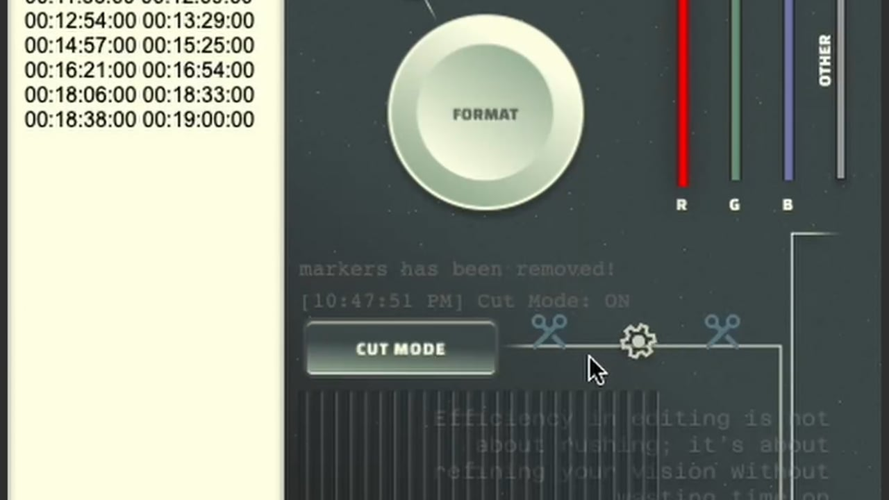
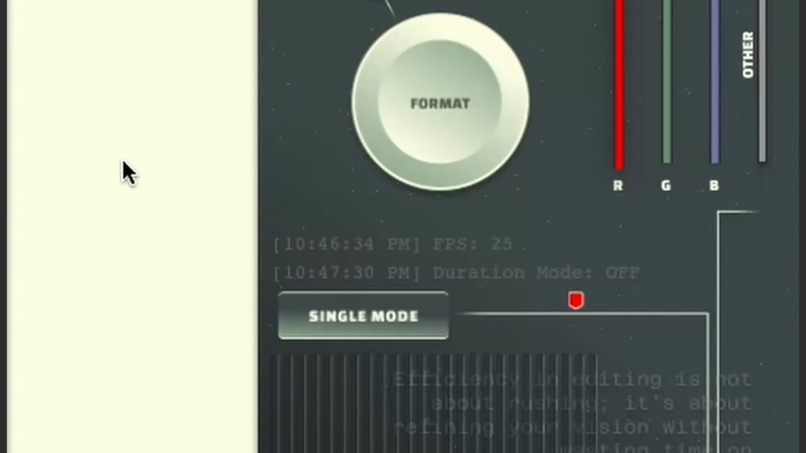

# Sergei Khlopov

### Video editing · Motion graphics · Creative tools

I create video and motion graphics, and build tools that make production easier. Editing and motion design experience since 2020, working with DaVinci Resolve, Premiere Pro, Fusion and After Effects.

## Selected motion work

<table>
<tr>
<td width="50%"></td>
<td width="50%"></td>
</tr>
<tr>
<td><a href="https://www.behance.net/gallery/238626397/Designers-forum-motion-design"><strong>Designers forum motion design</strong></a> Motion graphics for a design forum</td>
<td><a href="https://www.behance.net/gallery/238627153/Clean-intro-design"><strong>Clean intro design</strong></a> Intro & motion graphics</td>
</tr>
</table>

[More work on Behance](https://www.behance.net/dslrnt)

## Motion systems and procedural animation

A reusable After Effects promo template built from scratch, and an app intro created using a diffraction simulation.

<table><tr>
<td width="50%"></td>
<td width="50%"></td>
</tr><tr><td><strong>After Effects promo template</strong></td><td><strong>Procedural app intro</strong></td></tr></table>

[Process and project details →](projects/motion-experiments.md)

## Featured project — 50/50

An iPhone game about splitting a shape into two equal areas with one swipe. An idea I’d wanted to build since my student days — finally brought to life through vibe coding. I created the concept, visual design and animated interactions, then built a working prototype with AI coding assistance.

**In development · Game concept · UI & motion design · AI-assisted prototyping**

<table>
<tr>
<td></td>
<td></td>
<td></td>
</tr>
</table>

**[Explore the case study & gameplay →](projects/fifty-fifty.md)**

## Featured project — ScoreClicker

A personal tennis scorekeeping app for iPhone and Apple Watch. Visual design, procedural animation and AI-assisted development in one project.

**[Explore the project →](https://github.com/serj-the/scoreclicker-showcase)**

## Avtic Auto

My editing automation tool for Adobe Premiere Pro, available on aescripts. Originally built for my own workflow using AI coding assistance, with interface design created collaboratively.

In my own workflow, processing two hours of footage from a text brief takes about **30–60 minutes instead of 3 hours**.

50+ copies distributed, including free copies.

<table>
<tr>
<td width="50%"></td>
<td width="50%"></td>
</tr>
<tr>
<td><a href="https://vimeo.com/1078972595">▶ Watch editing demo</a></td>
<td><a href="https://vimeo.com/1078973934">▶ Watch workflow demo</a></td>
</tr>
</table>

[Product & demos](https://aescripts.com/avtic-auto/)

---

[Video & motion portfolio on Behance](https://www.behance.net/dslrnt)
