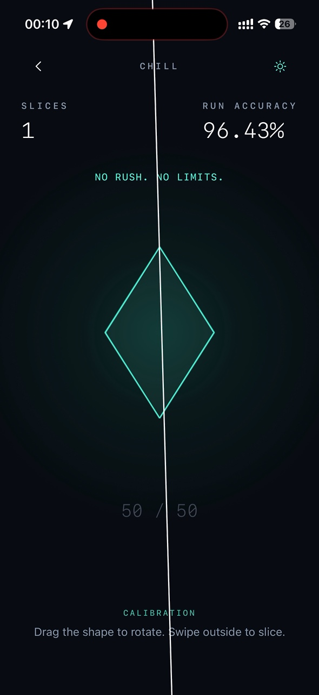
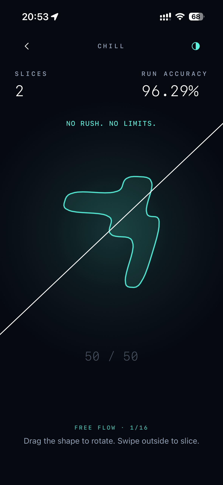
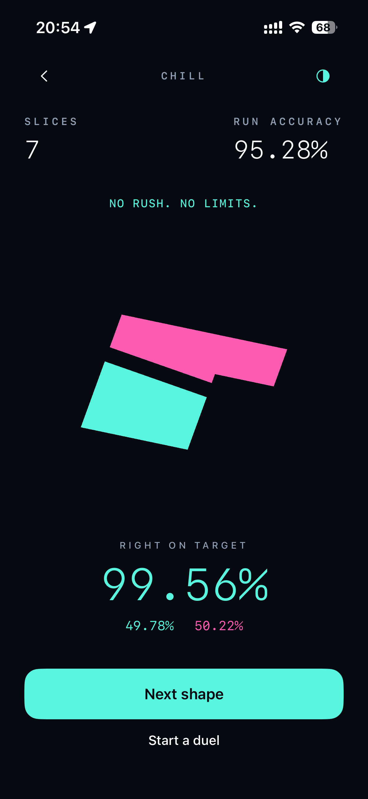

# 50/50 — Precision through motion

**Native iOS game · In development · 2026**

A simple challenge: divide a shape into two equal areas with a single straight swipe. The result is calculated from the geometry and displayed to two decimal places.

I’d wanted to make this game since my student days. Years later, I finally vibe-coded it into a working prototype, using AI coding tools to turn the idea into something I could play.

I designed the game concept, visual identity and interaction flow, then developed a working SwiftUI + SpriteKit prototype with AI coding assistance. The design keeps the shape at the centre: it stays in place as the menu becomes gameplay, responds to rotation gestures, and separates into coloured halves after a cut.

Motion communicates intent as well as reward. A dashed guide becomes solid when a cut is ready; moving back cancels it. PERFECT results dissolve into a glow, while consecutive successes send a growing multiplier into the header, accompanied by rhythmic haptics and synthesized sound.

The prototype includes relaxed and timed modes, varied procedural silhouettes, occasional alphabet shapes, local records, and seed-based QR duels that reproduce the same shape on another device. English, Russian and Spanish interfaces are available.

**My focus:** concept, visual design, motion direction, interaction design and iterative AI-assisted development.

**Status:** working prototype; not yet released on the App Store. QR links currently open the installed app. Additional levels remain planned.

## Gameplay

A 15-second recording from the running app: menu transitions, cutting shapes and PERFECT feedback.

[▶ Watch gameplay (MP4)](../assets/fifty-fifty/gameplay.mp4)

## Screens from the running prototype

Screenshots from the running app, showing the menu, gameplay and scoring feedback.

<table>
<tr>
<td> <strong>One shape, one continuous flow.</strong> A custom mode selector keeps the menu focused.</td>
<td> <strong>A quiet playfield.</strong> A diagonal guide shows the intended cut, with run accuracy displayed above.</td>
</tr>
<tr>
<td> <strong>Precision made visible.</strong> Colour and area percentages explain the result.</td>
<td> <strong>Momentum, without clutter.</strong></td>
</tr>
</table>

[Back to profile](../README.md)
