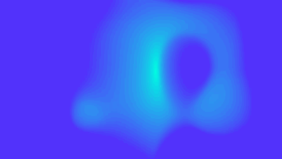

# Motion design and reusable tools

## After Effects promo template

Designed and built from scratch as a reusable promotional sequence: animated typography, a moving border, a fluid colour background, a logo reveal and a replaceable media area.

[Download typography animation (MP4)](../assets/motion/template.mp4)

*Preview: the opening 7.5 seconds of the typography sequence.*

### Design and implementation

- Built a 20-second loop-ready composition, designed for 4K at 60 fps.
- Created three editable central phrases and two border text elements.
- Used expressions that read text bounds to support the layout, plus shared base and accent colour controls.
- Organised logo and media replacement in dedicated precompositions.
- Prepared an After Effects template and editing documentation for reuse.

The template documentation specifies After Effects CC 2020 or newer, no external plugins, and single-line English text for the editable phrases. The preview is an excerpt; the reusable project is maintained separately.

**Tools:** Adobe After Effects, expressions, shape layers, typography animation and precompositions.

## ScoreClicker procedural intro

A four-second intro for my scorekeeping app, created using a Fraunhofer diffraction simulation. I used the simulation to develop a luminous, spectral treatment for the app identity.

The animation connects my interest in procedural graphics with interface and motion design.

[Download intro (MP4)](../assets/motion/diffraction-intro.mp4) · [ScoreClicker project](https://github.com/serj-the/scoreclicker-showcase)

---

[Back to profile](../README.md)
